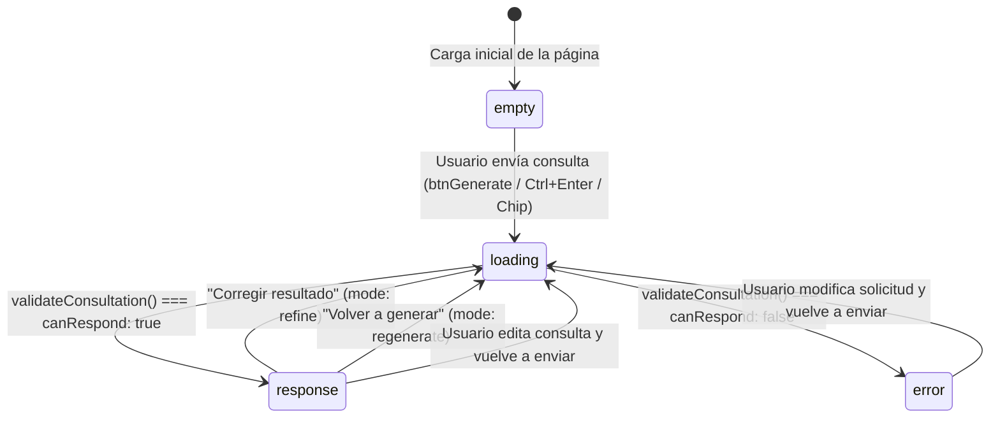

# CineMatch — Sistema de Curaduría y Recomendación Cinematográfica con IA

Documentación técnica, funcional y de diseño completa del proyecto **CineMatch**. Este documento está redactado para que cualquier desarrollador, evaluador o modelo de inteligencia artificial que inspeccione el repositorio por primera vez comprenda de principio a fin su contexto académico, su arquitectura de interfaz, su máquina de estados, su motor lógico en JavaScript y sus reglas estrictas de diseño visual.

---

## 1. Contexto y Objetivo del Proyecto

**CineMatch** es una aplicación web interactiva de **una sola pantalla (Single-Screen Application)** construida exclusivamente con **HTML5, CSS3 y JavaScript puro (Vanilla JS)**. Simula con lógica realista un asistente de inteligencia artificial especializado en recomendar películas, miniseries y documentales a partir de solicitudes escritas en lenguaje natural.

### 1.1. Requisitos funcionales cubiertos

El proyecto responde al diseño de una interfaz centrada en la interacción humano-IA (Human-in-the-Loop) que exige la presencia integrada y coherente de **ocho elementos fundamentales** en una única pantalla:

1. **Nombre de la aplicación** e identidad clara del sistema.
2. **Espacio de entrada** para que el usuario redacte su solicitud en lenguaje natural.
3. **Botón de acción principal** para enviar la consulta y generar el resultado.
4. **Indicador de procesamiento** que comunique visualmente cuándo la IA está analizando la petición.
5. **Respuesta generada por la IA** estructurada, clara y contextualizada a lo pedido.
6. **Opciones para editar, corregir o volver a generar** el resultado obtenido.
7. **Botones de valoración de utilidad** para indicar si la recomendación fue pertinente o no.
8. **Mensaje sencillo de límite o imposibilidad de respuesta** para cuando la IA no pueda atender la solicitud.

### 1.2. Los tres pilares conceptuales de la aplicación

Para efectos de análisis funcional o elaboración de informes sobre el proyecto, la solución se articula sobre tres ejes:

* **¿Qué hace la aplicación?**
  Actúa como un curador audiovisual personalizado. Recibe descripciones libres del usuario (género, trama, atmósfera, estado de ánimo, época o referencias) junto con filtros opcionales de tono y duración, y devuelve una ficha cinematográfica recomendada con título, dirección, año, duración, valoración crítica, justificación argumental redactada a medida y plataformas de catálogo donde se encuentra disponible.
* **¿Cómo ayuda la inteligencia artificial?**
  Reduce la fatiga de decisión frente a catálogos extensos de *streaming*. En lugar de obligar al usuario a navegar por decenas de categorías rígidas, interpreta intenciones expresadas en lenguaje cotidiano, cruza simultáneamente restricciones de tono y tiempo, descarta opciones repetidas y sintetiza en segundos una explicación razonada de por qué determinada obra encaja con su búsqueda.
* **¿De qué manera el usuario conserva el control sobre el resultado?**
  La IA nunca impone una decisión cerrada ni opera como una caja negra:
  1. *Antes de generar:* el usuario delimita libremente su petición y puede fijar restricciones explícitas de tono narrativo y extensión máxima.
  2. *Después de generar:* dispone de tres mecanismos directos de intervención: **Corregir resultado** (enviar una instrucción correctiva puntual a la IA, por ejemplo «prefiero algo más corto» o «más reciente»), **Editar solicitud** (volver al texto original para reformularlo) y **Volver a generar** (descartar la propuesta actual y exigir una alternativa distinta sin repetición inmediata).
  3. *Evaluación explícita:* califica si la sugerencia **Fue útil** o **No fue útil**; en caso negativo, la interfaz despliega automáticamente el cuadro de corrección para guiar el ajuste.
  4. *Transparencia de límites:* cuando la consulta carece de sentido o se sale del dominio cinematográfico, el sistema informa con claridad por qué no puede responder e invita a reformular la solicitud.

---

## 2. Estructura de Archivos y Stack Tecnológico

El proyecto no utiliza *frameworks* externos, empaquetadores (*bundlers*) ni dependencias de Node para su ejecución. Funciona directamente en cualquier navegador moderno.

```text
tarea-interfaz-ia/
├── index.html   # Estructura semántica de pantalla única y definición de los 4 estados de vista
├── styles.css   # Sistema de diseño editorial, variables CSS en tonos pastel, tipografías y layout responsivo
├── script.js    # Máquina de estados, validación de dominio, motor de puntuación semántica y eventos UI
└── README.md    # Documentación integral del proyecto
```

* **HTML5 (`index.html`):** Estructura semántica dividida en cabecera de identidad (`.masthead`) y área de trabajo a dos columnas (`.workspace-grid`), con atributos de accesibilidad (`aria-label`, `aria-live="polite"`, `aria-pressed`, `role="alert"`).
* **CSS3 (`styles.css`):** Variables nativas en `:root`, maquetación con CSS Grid y Flexbox, animaciones suaves (`softFadeIn`, `gentleRipple`, `calmSlide`) e ilustraciones/motivos vectoriales en SVG.
* **JavaScript ES6+ (`script.js`):** Lógica modular encapsulada en `DOMContentLoaded`, sin mutaciones globales contaminantes, encargada de gestionar el ciclo de vida completo de cada consulta.
* **Tipografías externas (Google Fonts CDN):** Carga optimizada de las familias `Lora`, `Quicksand` y `Nunito`.

---

## 3. Trazabilidad Exacta entre Requisitos y Código

La siguiente tabla relaciona cada requisito funcional con sus selectores en `index.html`, sus estilos en `styles.css` y su lógica en `script.js`:

| # | Requisito | Elementos en `index.html` | Clases clave en `styles.css` | Funciones y manejadores en `script.js` |
| :- | :--- | :--- | :--- | :--- |
| **1** | **Nombre de la aplicación** | `<header class="masthead">`, `<h1 class="brand-name">CineMatch</h1>`, `#headerStatusText` | `.masthead`, `.brand-name`, `.brand-emblem`, `.brand-edition`, `.system-meta` | Actualización dinámica de `#headerStatusText` y `.status-dot.busy` durante el procesamiento. |
| **2** | **Espacio para escribir solicitud** | `<textarea id="userPrompt">`, `#charCounter`, `#btnClearPrompt`, `.preset-chip`, `#selectMood`, `#selectDuration` | `.textarea-container`, `.editorial-textarea`, `.preset-chip`, `.params-grid` | `updatePromptUI()`, atajo `Ctrl+Enter` / `Cmd+Enter`, limpieza con `btnClearPrompt` y carga rápida mediante `.preset-chip`. |
| **3** | **Botón para enviar o generar** | `<form id="recommendationForm">`, `<button type="submit" id="btnGenerate">`, `#btnGenerateLabel` | `.submit-module`, `.btn-generate`, `.btn-generate:disabled` | Evento `submit` en `recommendationForm` que invoca `processUserConsultation({ mode: 'initial' })`. Bloqueo temporal mientras `isProcessing === true`. |
| **4** | **Indicador de IA procesando** | `<div id="loadingSection">`, `<span id="loadingStepText">` | `.processing-state`, `.processing-card`, `.pulse-ring`, `.processing-bar` | `showRightPanelState('loading')`, temporizadores escalonados `activeTimerStep` (650 ms) y `activeTimerDone` (1350 ms). |
| **5** | **Respuesta generada por la IA** | `<div id="responseSection">`, `#displayedUserQuery`, `#moviePoster`, `#movieTitle`, `#movieDirector`, `#movieMatch`, `#movieMeta`, `#aiResponseText`, `#moviePlatforms` | `.dossier-card`, `.poster-frame`, `.film-title`, `.meta-tag`, `.rationale-block`, `.rationale-text` | `selectBestMatch()`, `composePersonalizedRationale()`, `populateResponseCard()`, `showRightPanelState('response')`. |
| **6** | **Editar, corregir o regenerar** | `#btnOpenRefine`, `#refinePanel`, `#refineInput`, `#btnApplyRefine`, `#btnCancelRefine`, `#btnEditPrompt`, `#btnRegenerate` | `.dossier-footer`, `.control-actions`, `.refine-drawer`, `.btn-outline`, `.btn-outline-sage` | `submitRefinement()` (`mode: 'refine'`), `focusOriginalPrompt()` (resalta y enfoca `#userPrompt`), `btnRegenerate` (`mode: 'regenerate'`). |
| **7** | **Botones de utilidad** | `#btnUsefulYes`, `#btnUsefulNo`, `<p id="feedbackConfirmMsg">` | `.utility-evaluation`, `.btn-utility`, `.active-useful`, `.active-not-useful`, `.feedback-note` | `resetUtilityFeedback()`, eventos `click` en `btnUsefulYes` y `btnUsefulNo` (este último abre `#refinePanel` automáticamente). |
| **8** | **Mensaje cuando no puede responder** | `<div id="errorSection">`, `#errorHeading`, `#errorText`, `#btnFocusPromptFromError` | `.limit-state-wrapper`, `.limit-notice`, `.limit-heading`, `.limit-message`, `.btn-limit-restore` | `validateConsultation()`, `NON_CINEMA_PATTERNS`, `GREETING_ONLY`, `showRightPanelState('error')`. |

---

## 4. Arquitectura de Layout y Máquina de Estados

### 4.1. Distribución espacial de pantalla única

La interfaz está contenida en `.workspace-sheet` (ancho máximo `1220px`), dividida en dos regiones persistentes bajo la cabecera:

* **Columna izquierda (`.column-left`, proporción `5fr`):** Permanece siempre visible y accesible. Contiene el área de escritura (`#userPrompt` con límite de 300 caracteres), chips de sugerencias opcionales, dos selectores de preferencias (`#selectMood` y `#selectDuration`) y el botón primario `#btnGenerate`.
* **Columna derecha (`.column-right`, proporción `7fr`):** Es el lienzo reactivo donde se proyecta el estado actual de la IA. Nunca apila estados contradictorios al mismo tiempo.

### 4.2. Máquina de estados mutuamente excluyentes

La función `showRightPanelState(stateName)` en `script.js` garantiza que **exactamente uno** de los cuatro contenedores del panel derecho esté visible en cada momento (alternando la clase `.hidden`):



1. **Estado `empty` (`#emptyState`):** Estado inicial limpio al cargar la aplicación. Invita al usuario a escribir qué desea ver sin mostrar resultados artificiales precargados ni alertas prematuras.
2. **Estado `loading` (`#loadingSection`):** Se activa inmediatamente al enviar cualquier consulta, corrección o regeneración. Deshabilita `#btnGenerate`, cambia el estado de cabecera a `Analizando solicitud...` y actualiza dinámicamente el subtítulo de progreso en dos etapas (`0 ms` y `650 ms`) antes de resolver a los `1350 ms`.
3. **Estado `response` (`#responseSection`):** Presenta la tarjeta editorial de la película o miniserie seleccionada, la consulta utilizada como contexto, el cajón colapsable de corrección (`#refinePanel`) y el pie de acciones y utilidad.
4. **Estado `error` (`#errorSection`):** Muestra el aviso sereno de imposibilidad de respuesta con título específico (`#errorHeading`), explicación sencilla (`#errorText`) y el botón `Modificar solicitud` (`#btnFocusPromptFromError`) que devuelve el foco al cuadro de texto izquierdo.

---

## 5. Funcionamiento Interno del Motor en JavaScript (`script.js`)

### 5.1. Validación y detección de límites (`validateConsultation`)

Antes de recomendar una obra, el sistema evalúa el texto ingresado (combinando la consulta original y cualquier nota de corrección) a través de cuatro filtros secuenciales:

1. **Consulta vacía:** Si el usuario pulsa «Generar recomendación» sin haber escrito texto, devuelve `canRespond: false` indicando *«Aún no ha escrito una solicitud»*.
2. **Saludo aislado (`GREETING_ONLY`):** Expresión regular que detecta entradas como `"hola"`, `"buenas tardes"` o `"qué tal"` sin ninguna petición cinematográfica, pidiendo amablemente detalles sobre qué desea ver.
3. **Texto ininteligible o pulsaciones aleatorias:** Filtra caracteres alfabéticos y vocales (`lettersOnly` y `vowelsOnly`). Entradas menores a 4 caracteres, números sueltos (`"12345"`) o cadenas sin vocales (`"asdfgh"`) son rechazadas con el aviso *«No pudimos interpretar su solicitud»*.
4. **Consultas fuera de dominio (`NON_CINEMA_PATTERNS` + detector matemático):** Comprueba si el usuario solicita tareas ajenas al ámbito audiovisual (derivadas, ecuaciones, cálculos aritméticos directos como `"cuánto es 45 * 12"`, recetas de cocina, programación en Python/JavaScript, contratos legales, diagnósticos médicos, claves bancarias, clima o divisas). En tales casos retorna `canRespond: false` y activa el mensaje sencillo requerido por la tarea explicando que CineMatch solo recomienda cine, series y documentales.

### 5.2. Algoritmo de puntuación y selección (`selectBestMatch`)

Cuando la consulta es válida, `selectBestMatch(searchText, excludeRecent)` puntúa las 12 obras de `CATALOG` aplicando reglas ponderadas:

* **Coincidencia semántica de palabras clave:** `+5 puntos` por cada término del arreglo `keywords` de la obra presente en el texto del usuario.
* **Afinidad con el selector de tono (`#selectMood`):** `+3 puntos` si el tono elegido figura en el arreglo `tones` de la obra.
* **Inferencia de formato (Película vs. Miniserie):** Detecta tanto por el selector `#selectDuration === 'Miniserie corta'` como por lenguaje natural (`"serie"`, `"miniserie"`, `"capítulos"`, `"episodios"`). Si el usuario busca serie, suma `+7 puntos` a miniseries y resta `-3` a largometrajes; si fijó una duración de película, penaliza las series con `-4`.
* **Inferencia de duración corta:** Si elige `Menos de 2 horas` o escribe términos como `"corta"`, `"breve"` o `"menos de dos horas"`, otorga `+4 puntos` a películas de `<= 120 minutos` y resta `-2` a las más extensas.
* **Inferencia de actualidad:** Si menciona `"reciente"`, `"nueva"` o `"actual"`, suma `+3 puntos` a estrenos desde `2019` en adelante.
* **Memoria antirrepetición (`shownHistory`):** Guarda hasta las últimas 5 obras mostradas. Si el usuario pulsa **Volver a generar** o **Corregir resultado** (`excludeRecent = true`), la película inmediatamente anterior recibe `-100 puntos`, garantizando que siempre aparezca una propuesta distinta. Las demás obras vistas recientemente reciben una penalización leve de `-2 puntos` para favorecer variedad.

### 5.3. Redacción contextual de la respuesta (`composePersonalizedRationale`)

El texto de `#aiResponseText` no es estático; construye una introducción adaptada al modo de invocación seguida del análisis de la obra:

* **`mode === 'initial'`:** Menciona los filtros activos de tono y duración si el usuario los seleccionó, o vincula directamente la recomendación con los criterios descritos en la consulta.
* **`mode === 'refine'`:** Cita explícitamente la corrección escrita por el usuario (*«Tomando en cuenta su indicación («...»), hemos ajustado la selección hacia...»*) y muestra la insignia `#refinementBadge` con el texto *«Ajustada según su corrección»*.
* **`mode === 'regenerate'`:** Introduce la ficha como una alternativa distinta para la misma búsqueda y actualiza `#refinementBadge` a *«Nueva alternativa generada»*.

### 5.4. Catálogo interno incluido (`CATALOG`)

El catálogo cuenta con **25 películas y series ampliamente conocidas** distribuidas en todos los géneros principales:

| ID | Obra | Año | Formato / Extensión | Tema de póster | Motivo SVG | Géneros principales cubiertos |
| :--- | :--- | :-: | :--- | :--- | :--- | :--- |
| `interstellar` | *Interestelar (Interstellar)* | 2014 | Película · 169 min | `poster-mist` | `orbit` | Ciencia ficción épica, espacio, aventura |
| `inception` | *El origen (Inception)* | 2010 | Película · 148 min | `poster-sage` | `prism` | Ciencia ficción, sueños, acción y suspenso |
| `back-to-future` | *Volver al futuro* | 1985 | Película · 116 min | `poster-sand` | `hourglass` | Viajes en el tiempo, aventura, clásico familiar |
| `avatar` | *Avatar* | 2009 | Película · 162 min | `poster-sage` | `orbit` | Ciencia ficción, aventura épica, fantasía |
| `dark-knight` | *Batman: El caballero de la noche* | 2008 | Película · 152 min | `poster-mist` | `crosshair` | Acción, superhéroes, policial, Joker |
| `avengers-endgame` | *Avengers: Endgame* | 2019 | Película · 181 min | `poster-clay` | `prism` | Marvel, superhéroes, acción y aventura épica |
| `top-gun-maverick` | *Top Gun: Maverick* | 2022 | Película · 130 min | `poster-sand` | `prism` | Acción, adrenalina, aviación, reciente |
| `john-wick` | *John Wick: Otro día para matar* | 2014 | Película · 101 min | `poster-mist` | `crosshair` | Acción intensa, artes marciales, corta |
| `gladiator` | *Gladiador (Gladiator)* | 2000 | Película · 155 min | `poster-sand` | `arch` | Acción histórica, drama épico, Roma |
| `shutter-island` | *La isla siniestra (Shutter Island)* | 2010 | Película · 138 min | `poster-mist` | `crosshair` | Suspenso psicológico, misterio, investigación |
| `parasite` | *Parásitos (Parasite)* | 2019 | Película · 132 min | `poster-olive` | `frame` | Suspenso, giros impredecibles, comedia negra |
| `now-you-see-me` | *Los ilusionistas* | 2013 | Película · 115 min | `poster-sage` | `prism` | Misterio, magia, robos e intriga ágil |
| `coco` | *Coco* | 2017 | Película · 105 min | `poster-clay` | `arch` | Animación Pixar, familiar, música, emotiva |
| `shrek` | *Shrek* | 2001 | Película · 90 min | `poster-olive` | `frame` | Comedia animada, aventura, humor familiar |
| `spider-verse` | *Spider-Man: Un nuevo universo* | 2018 | Película · 117 min | `poster-clay` | `orbit` | Animación, Spider-Man, acción y superhéroes |
| `forrest-gump` | *Forrest Gump* | 1994 | Película · 142 min | `poster-sand` | `arch` | Comedia dramática, historia inspiradora |
| `truman-show` | *The Truman Show* | 1998 | Película · 103 min | `poster-sage` | `frame` | Comedia dramática, sátira, Jim Carrey |
| `hangover` | *¿Qué pasó ayer? (The Hangover)* | 2009 | Película · 100 min | `poster-sand` | `prism` | Comedia pura, amigos, risas, corta |
| `conjuring` | *El conjuro (The Conjuring)* | 2013 | Película · 112 min | `poster-olive` | `prism` | Terror paranormal, sustos, hechos reales |
| `quiet-place` | *Un lugar en silencio (A Quiet Place)* | 2018 | Película · 90 min | `poster-mist` | `crosshair` | Terror y suspenso, tensión, supervivencia |
| `la-la-land` | *La La Land* | 2016 | Película · 128 min | `poster-clay` | `arch` | Romance, musical moderno, drama |
| `titanic` | *Titanic* | 1997 | Película · 194 min | `poster-mist` | `arch` | Romance clásico, drama histórico |
| `oppenheimer` | *Oppenheimer* | 2023 | Película · 180 min | `poster-sand` | `orbit` | Historia, biografía, hechos reales, reciente |
| `stranger-things` | *Stranger Things* | 2016 | Serie · Episodios 50m | `poster-clay` | `orbit` | Serie de misterio, ciencia ficción, aventura |
| `chernobyl` | *Chernobyl* | 2019 | Miniserie · 5 episodios | `poster-mist` | `hourglass` | Miniserie histórica, hechos reales |
| `queens-gambit` | *Gambito de dama* | 2020 | Miniserie · 7 episodios | `poster-sage` | `hourglass` | Miniserie dramática, superación |

---

## 6. Sistema de Diseño y Reglas Estrictas de Estilo

Cualquier modificación futura sobre este proyecto (ya sea por un desarrollador o por otra IA) **debe respetar tres directrices estéticas innegociables**:

### 6.1. Regla 1: Prohibición absoluta de emojis

No debe existir ningún carácter emoji en `index.html`, `styles.css` ni `script.js`. Toda la iconografía se resuelve exclusivamente mediante trazos vectoriales SVG minimalistas (`stroke-width: 1.2` a `1.9`) y los pósteres utilizan composiciones geométricas abstractas (`MOTIFS`) acompañadas de códigos de catálogo (`CAT · 014`, `SER · 011`).

### 6.2. Regla 2: Paleta armónica de tonos pastel cálidos (sin morados ni colores estridentes)

Se descartó deliberadamente la estética genérica oscura con luces neón o tonos morados/violetas. La interfaz emplea una paleta editorial luminosa, serena y descansada para la vista:

* **Superficies base:**
  * `--bg-canvas: #f0ede6` (Lino piedra cálido para el fondo exterior)
  * `--bg-sheet: #faf8f4` (Papel marfil suave para el contenedor principal)
  * `--bg-elevated: #ffffff` (Blanco limpio para tarjetas e *inputs*)
  * `--bg-subtle: #f3f0e8` (Avena tenue para fondos secundarios y citas)
* **Acento principal — Pastel Salvia:**
  * `--sage-pastel: #dfebe3` / Borde `#bfd3c6` / Tinta y botón primario `--sage-deep: #3f5d4f` (Hover `#324b3f`).
* **Estado de procesamiento e información — Pastel Bruma Azul-Gris:**
  * `--mist-pastel: #e4edf2` / Borde `#c5d5df` / Tinta `--mist-ink: #3e5869`.
* **Metadatos cinematográficos — Pastel Arena / Trigo:**
  * `--sand-pastel: #f2ecde` / Borde `#ded3bc` / Tinta `--sand-ink: #685a41`.
* **Aviso de límite o no utilidad — Pastel Arcilla / Terracota suave:**
  * `--clay-pastel: #f6eae6` / Borde `#dfc4bc` / Tinta `--clay-ink: #7d473a`.
* **Tintas de texto (sin negro puro agresivo):**
  * `--ink-primary: #252b28`, `--ink-secondary: #565d59`, `--ink-muted: #7e8580`.

### 6.3. Regla 3: Sistema de tres tipografías suaves y claramente diferenciadas

Para evitar una apariencia plana o rígida, el proyecto combina tres familias suaves con roles jerárquicos bien delimitados:

1. **`Lora` (`--font-editorial`):** Serif caligráfica de curvas orgánicas e itálicas fluidas. Se aplica en el nombre de la aplicación (`CineMatch`), subtítulo de marca, encabezados de bloque, título y dirección de la obra recomendada, notas de retroalimentación y **todo el cuerpo de la respuesta generada por la IA** (`.rationale-text`), otorgándole carácter de reseña editorial.
2. **`Quicksand` (`--font-ui`):** Sans geométrica de terminales redondeadas. Se aplica en botones, etiquetas de paso (`Consulta`, `Filtros`), insignias pasteles, porcentajes de afinidad, píldoras de metadatos y chips de sugerencia rápida.
3. **`Nunito` (`--font-body`):** Sans humanista suave y equilibrada. Se utiliza en el área de texto donde escribe el usuario, los selectores desplegables, las ayudas contextuales y los párrafos informativos de estado vacío o límite.

---

## 7. Ejecución y Casos de Prueba Recomendados

### 7.1. Cómo ejecutar la aplicación

No requiere instalación ni servidor de compilación:

1. Abrir directamente el archivo `index.html` con doble clic en cualquier navegador moderno (Chrome, Edge, Firefox, Safari), o bien
2. Servir la carpeta con cualquier servidor estático local (por ejemplo, la extensión *Live Server* en VS Code o `python -m http.server 8080`).

### 7.2. Batería de pruebas para verificar todos los comportamientos

1. **Estado inicial limpio:** Al cargar la página, comprobar que el cuadro de texto está vacío y el panel derecho muestra *«Su espacio de recomendación está listo»*.
2. **Generación válida por escritura libre:** Escribir *«Quiero una película de terror psicológico en una casa aislada»* y pulsar **Generar recomendación** (o `Ctrl + Enter`). Se observará la transición por el indicador de procesamiento (`#loadingSection`) y la aparición de la ficha de *Los otros (The Others)*.
3. **Uso de filtros + consulta:** Seleccionar `Duración: Miniserie corta`, escribir *«algo basado en hechos reales»* y generar; el motor priorizará *Chernobyl (Miniserie)*.
4. **Corrección interactiva del resultado:** Con una recomendación en pantalla, pulsar **Corregir resultado**, escribir *«prefiero una comedia ligera y corta»* y pulsar **Aplicar corrección**. La IA volverá a procesar, mostrará la etiqueta *«Ajustada según su corrección»* y cambiará la propuesta citando la indicación del usuario.
5. **Volver a generar sin repetición:** Pulsar **Volver a generar**; la IA procesará de nuevo y entregará una alternativa diferente a la película recién mostrada.
6. **Edición de solicitud original:** Pulsar **Editar solicitud**; el cursor se situará al final del cuadro izquierdo resaltando su borde para modificar el texto inicial.
7. **Valoración de utilidad:**
   * Pulsar **Sí, fue útil** para verificar la confirmación positiva.
   * Pulsar **No fue útil** para comprobar el aviso correspondiente y la apertura automática del cajón de corrección.
8. **Mensaje cuando la IA no puede responder (3 escenarios):**
   * Enviar el formulario completamente vacío.
   * Escribir únicamente `Hola` o caracteres sin sentido como `asdfgh`.
   * Escribir una petición fuera de alcance, por ejemplo: `Resuelve una derivada de cálculo` o `Dame una receta de cocina`. En todos estos casos aparecerá el estado `#errorSection` explicando con sencillez el motivo y ofreciendo el botón **Modificar solicitud**.

---

## 8. Guía de Extensibilidad

* **Añadir nuevas películas o series:** Basta con agregar un nuevo objeto al arreglo `CATALOG` en `script.js` definiendo `id`, `title`, `director`, `year`, `minutes`, `isSeries`, `catalogCode`, `posterTheme` (`poster-sage`, `poster-mist`, `poster-sand`, `poster-olive` o `poster-clay`), `motif` (cualquiera de las claves de `MOTIFS`), `affinity`, `tones`, `keywords`, `meta`, `synopsis` y `platforms`.
* **Conectar una API de IA real en el futuro:** Toda la interfaz gráfica y la máquina de estados (`showRightPanelState`) ya están desacopladas del origen de datos. Para conectar un modelo real (como Gemini API u OpenAI), únicamente habría que reemplazar la resolución del `setTimeout` dentro de `processUserConsultation()` en `script.js` por una llamada asíncrona `fetch()` que devuelva un JSON con la misma estructura de `populateResponseCard()` o dispare `showRightPanelState('error')` cuando el modelo indique que la consulta está fuera de dominio.
